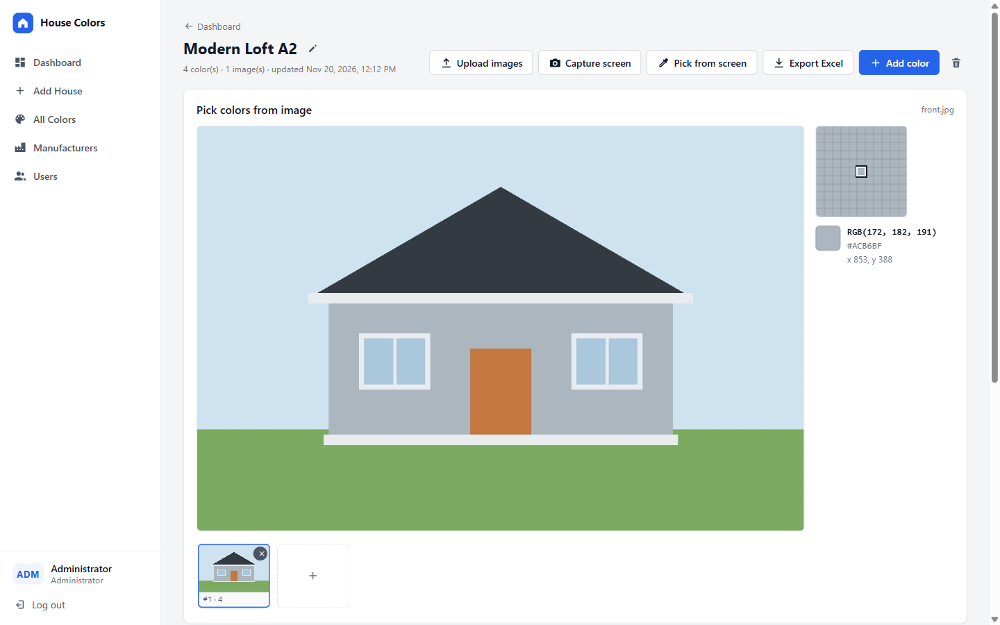
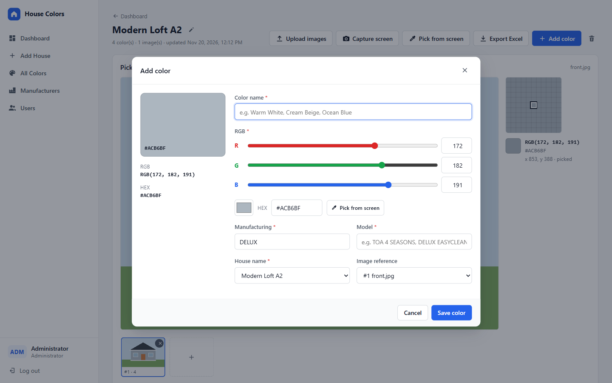
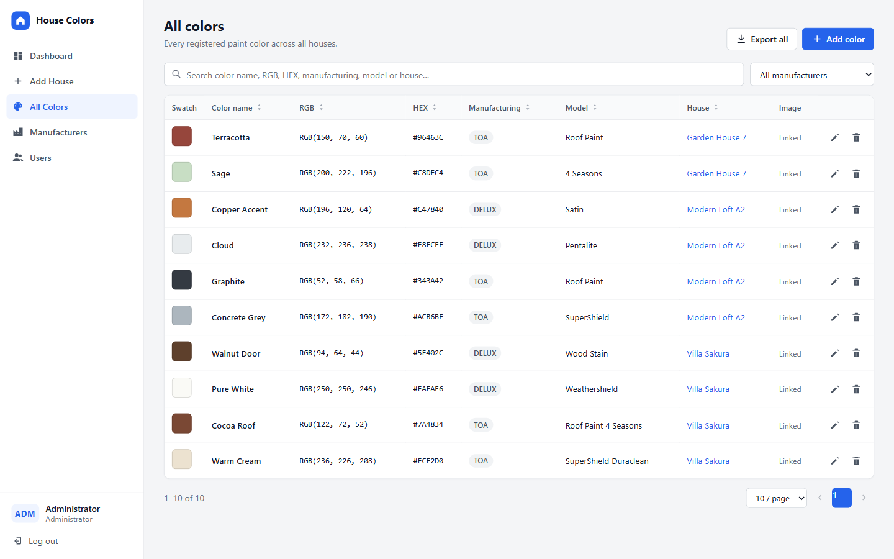

# House Color Management System

ระบบจัดการสีบ้าน: อัปโหลดรูปบ้าน คลิกบนรูปเพื่อดึงค่าสีจริงแบบแม่นยำระดับพิกเซล บันทึกรายละเอียดสี (ชื่อสี, RGB/HEX, ยี่ห้อ, รุ่น) แล้วค้นหาและส่งออกเป็น Excel ได้


| เลือกสีจากรูป (มีแว่นขยายพิกเซล) | บันทึกสีพร้อม RGB / HEX ยี่ห้อ และรุ่น |
|---|---|
|  |  |



*ภาพหน้าจอใช้ข้อมูลตัวอย่างที่สร้างขึ้น*

| ส่วน | เทคโนโลยี | รันที่ไหน |
|------|-----------|-----------|
| แอป (หน้าเว็บ + API) | Python 3.12, Flask 3, Jinja2, Flask-SQLAlchemy, Pillow, openpyxl | บนเครื่อง: `python app.py` |
| สคริปต์ฝั่งเบราว์เซอร์ | JavaScript ธรรมดา (ไม่ใช้ Node ไม่ต้อง build) | ส่งจากโฟลเดอร์ `static/` |
| ฐานข้อมูล | MySQL 8.4 + phpMyAdmin | Docker |

## เริ่มใช้งาน (Windows PowerShell)

```powershell
git clone https://github.com/Darkfullmoon/house-color-manager.git
cd house-color-manager

# 1. ฐานข้อมูล (Docker รันแค่ MySQL + phpMyAdmin)
copy .env.example .env               # ทำครั้งแรกครั้งเดียว แล้วแก้รหัสผ่านในไฟล์
docker compose up -d

# 2. แอป
python -m venv venv                  # ครั้งแรกเท่านั้น
.\venv\Scripts\Activate.ps1
pip install -r requirements.txt      # ครั้งแรกเท่านั้น
python app.py
```

| URL | คืออะไร |
|-----|---------|
| http://localhost:5000 | ตัวแอป (เครื่องอื่นในวง LAN เข้าได้ที่ `http://<IP-เครื่องนี้>:5000`) |
| http://localhost:8080 | phpMyAdmin (server `mysql`, user/password ตาม `.env`) |
| localhost:3321 | MySQL สำหรับโปรแกรมภายนอก |

`app.py` จะ:
- อ่านไฟล์ `.env` ของโปรเจกต์ให้อัตโนมัติ
- เชื่อม MySQL ที่ `127.0.0.1` พอร์ต `MYSQL_PORT` (3321)
- สร้างตารางตอนเริ่มรัน และเพิ่มยี่ห้อเริ่มต้น (TOA, DELUX) ให้

ค่าที่ตั้งไว้ใน environment ของเครื่องเองจะมีผลก่อนค่าใน `.env`

`python app.py` รัน Flask development server แบบ debug ซึ่งจะรีโหลดเองเมื่อแก้โค้ด ส่วนเทมเพลตและไฟล์ static จะเห็นผลเมื่อรีเฟรชหน้าเว็บ ไม่ต้อง build อะไร

ข้อมูลเก็บไว้ที่ไหน:
- **รูปภาพ** เป็นไฟล์อยู่ในโฟลเดอร์ `uploads/` ของโปรเจกต์ MySQL เก็บแค่ชื่อไฟล์ (`house_images.image_path`) ไม่เก็บตัวรูป
- **ฐานข้อมูล** อยู่ใน Docker volume ชื่อ `mysql_data`

ทั้งสองอย่างยังอยู่หลัง `docker compose down` / `up` ส่วน `docker compose down -v` จะลบ volume ฐานข้อมูล แต่ไฟล์รูปใน `uploads/` ยังอยู่ ถ้าจะสำรองข้อมูล ให้ copy โฟลเดอร์ `uploads/` และ dump ฐานข้อมูล

## บัญชีผู้ใช้

ทุกหน้า, API, รูปที่อัปโหลด และไฟล์ Excel ต้องล็อกอินก่อน

| ใคร | ชื่อผู้ใช้ | รหัสผ่าน | ทำอะไรได้ |
|-----|-----------|----------|-----------|
| ผู้ดูแลระบบ | `ADM` (ตายตัว) | `ADMIN_PASSWORD` ใน `.env` (ค่าเริ่มต้น `Test*123`) | ทำได้ทุกอย่าง รวมถึงเมนู **Users** และ **Manufacturers** |
| ผู้ใช้ทั่วไป | ตัวอักษรอังกฤษพิมพ์ใหญ่ 3 ตัว เช่น `ABC` | ตั้งเอง | ทุกอย่าง ยกเว้นสองเมนูข้างบน |

- ผู้ดูแลเพิ่มผู้ใช้ได้ที่หน้า **Users** ผู้ใช้ใหม่ล็อกอินด้วยรหัสเริ่มต้น (`DEFAULT_PASSWORD` ใน `.env` ค่าเริ่มต้น `Test*123`) แล้วต้องตั้งรหัสของตัวเองก่อนใช้งาน
- รหัสผ่านต้องยาวอย่างน้อย 8 ตัว มีตัวพิมพ์ใหญ่ ตัวเลข และอักขระพิเศษ และห้ามซ้ำกับรหัสเริ่มต้น
- **Reset password** ในหน้า Users จะตั้งรหัสผู้ใช้กลับเป็นรหัสเริ่มต้น (ผู้ใช้ต้องตั้งใหม่ตอนล็อกอินครั้งถัดไป) ส่วน **Disable** จะบังคับออกจากระบบและล็อกบัญชีจนกว่าจะเปิดใช้อีกครั้ง
- เปลี่ยนรหัสผู้ดูแลได้โดยแก้ `ADMIN_PASSWORD` ใน `.env` แล้วรัน `python app.py` ใหม่
- ผู้ใช้ทั่วไปไม่เห็นเมนู Manufacturers แต่ถ้าพิมพ์ชื่อยี่ห้อใหม่ในฟอร์มสี ชื่อนั้นจะถูกบันทึกให้ทุกคนใช้ได้

## ตัวแปรใน `.env`

| ตัวแปร | ค่าเริ่มต้น | ใช้ทำอะไร |
|--------|------------|-----------|
| `MYSQL_ROOT_PASSWORD` | – | รหัส root ของ MySQL |
| `DB_NAME` / `DB_USER` / `DB_PASSWORD` | `house_colors` / `housecolor` / – | ชื่อฐานข้อมูลและบัญชีที่แอปใช้ (ใช้ทั้งฝั่ง MySQL และ `app.py`) |
| `MYSQL_PORT` / `PMA_PORT` | 3321 / 8080 | พอร์ตบนเครื่องของ MySQL และ phpMyAdmin |
| `MAX_UPLOAD_MB` | 20 | ขนาดอัปโหลดสูงสุดต่อครั้ง |
| `SECRET_KEY` | – | ใช้เซ็น session การล็อกอิน ควรเป็นข้อความสุ่มยาว ๆ |
| `ADMIN_PASSWORD` | `Test*123` | รหัสผ่านของผู้ดูแล `ADM` |
| `DEFAULT_PASSWORD` | `Test*123` | รหัสของผู้ใช้ใหม่และหลัง reset |
| `DB_HOST` / `UPLOAD_FOLDER` | `127.0.0.1` / `uploads/` | ใช้เมื่อต้องการเปลี่ยนค่า (ไม่บังคับ) |

ค่าบัญชีฐานข้อมูลมีผลเฉพาะตอนสร้าง volume `mysql_data` ครั้งแรก ถ้าจะเปลี่ยนภายหลัง ต้องเปลี่ยนใน MySQL ด้วย หรือสร้าง volume ใหม่

## วิธีใช้งาน

1. กด **Add house** ใส่ชื่อบ้าน แล้วเพิ่มรูปอย่างน้อยหนึ่งรูป ทำได้ 3 แบบ: อัปโหลดไฟล์, กด **Capture screen**, หรือวางภาพหน้าจอด้วย Ctrl+V
2. ในหน้าบ้าน เลื่อนเมาส์บนรูปจะเห็นแว่นขยายพิกเซล คลิกเพื่อเลือกสี ฟอร์มจะเปิดขึ้นพร้อมค่า RGB ของพิกเซลนั้นพอดี
3. กรอกรายละเอียดสี:
   - ชื่อสี
   - ยี่ห้อ: เลือก TOA/DELUX หรือพิมพ์ชื่อใหม่ ระบบจะจำไว้ใช้ครั้งต่อไป
   - รุ่น: เก็บเป็นตัวพิมพ์ใหญ่เสมอ
   - บ้าน

   ปรับค่า RGB ได้ทั้งจากแถบเลื่อน ช่องตัวเลข ตัวเลือกสีของเบราว์เซอร์ หรือช่อง HEX

   เมื่อเพิ่มสีใหม่ ช่องยี่ห้อจะตั้งเป็นยี่ห้อของสีล่าสุดของบ้านนั้นไว้ให้ จึงเลือกแค่ครั้งเดียวต่อบ้าน เปลี่ยนได้เมื่อสีนั้นเป็นยี่ห้ออื่น
4. หน้า **Dashboard** แสดงบ้านทุกหลังพร้อมตัวอย่างสี
   - ค้นหาได้จากชื่อสี, RGB (`200,180,150`, `200 180 150` หรือ `RGB(200, 180`), HEX, ยี่ห้อ, รุ่น และชื่อบ้าน
   - กรองตามยี่ห้อได้
5. **Export all** (หน้า Dashboard / All Colors) ดาวน์โหลดไฟล์ `House_Color_Database.xlsx` ส่วน **Export Excel** ในหน้าบ้านจะได้ไฟล์ `House_Color_<ชื่อบ้าน>.xlsx`
   - คอลัมน์: House Name, Color Name, RGB, HEX, Manufacturing, Model, Image Reference
   - สร้างไฟล์ฝั่งเซิร์ฟเวอร์ด้วย openpyxl

### ดึงสีจากหน้าจอ
ฟีเจอร์นี้ต้องใช้ Chrome หรือ Edge บนเครื่องนี้ และเปิดที่ `http://localhost:5000` (เบราว์เซอร์อนุญาตเฉพาะ `localhost` หรือ HTTPS และใช้บนมือถือไม่ได้)

- **Pick from screen** (หน้าบ้านและฟอร์มสี): เมาส์จะกลายเป็นหลอดดูดสี คลิกพิกเซลไหนบนจอก็ได้ แม้อยู่นอกเบราว์เซอร์ ฟอร์มสีจะเปิดพร้อมสีนั้น กด Esc เพื่อยกเลิก สีที่ได้วิธีนี้จะไม่มีรูปอ้างอิง
- **Capture screen** (หน้า Add house และหน้าบ้าน): เบราว์เซอร์จะถามว่าจะแชร์จอ หน้าต่าง หรือแท็บไหน เลือกแล้วภาพนั้นจะถูกเพิ่มเข้าบ้าน พร้อมให้เลือกสี (เบราว์เซอร์ถามทุกครั้ง ข้ามขั้นนี้ไม่ได้)
- **Ctrl+V** ในหน้า Add house หรือหน้าบ้าน จะเพิ่มรูปจาก clipboard ให้จับภาพหน้าจอก่อนด้วย Win+Shift+S (ตัดบางส่วน) หรือ PrintScreen แล้วกด Ctrl+V บนหน้าเว็บ (หน้าเว็บมองไม่เห็นการกดปุ่มจับภาพ จึงต้องกด Ctrl+V เอง)

### การดึงค่าพิกเซลทำงานอย่างไร
รูปจะถูกวาดลง `<canvas>` ที่ความละเอียดจริงของรูป ตำแหน่งที่คลิกบนจอจะถูกแปลงกลับเป็นพิกัดพิกเซลของรูปต้นฉบับ แล้วใช้ `getImageData(x, y, 1, 1)` อ่านค่าพิกเซลเดียว ค่าที่ได้จึงตรงเป๊ะแม้รูปจะแสดงแบบย่อ และเพราะ Flask ส่งรูปมาจาก origin เดียวกัน canvas จึงไม่ถูก "taint"

## โครงสร้างโปรเจกต์

```
house-color-manager/
  app.py             route ทั้งหมด: หน้าเว็บ, JSON API, อัปโหลด, export Excel, ตรวจสอบข้อมูล
  models.py          โมเดล SQLAlchemy
  requirements.txt
  templates/         หน้า Jinja (Flask เติมข้อมูลฝั่งเซิร์ฟเวอร์)
    base.html          layout + แถบเมนูข้าง
    macros.html        swatch, chips, หัวตารางเรียงลำดับ, แบ่งหน้า
    dashboard.html, colors.html, house_detail.html, add_house.html, manufacturers.html, error.html
    _color_table.html  ตารางสีที่ใช้ร่วมกัน
  static/            ไฟล์ที่ส่งให้เบราว์เซอร์ตรง ๆ
    css/styles.css
    js/              ui.js (toast, modal, confirm), api.js, color.js,
                     picker.js, color_form.js, manufacturer_select.js, dropzone.js,
                     house_detail.js, add_house.js, colors_page.js, manufacturers.js, color_actions.js
  tests/             pytest (ใช้ SQLite ในหน่วยความจำ ไม่ต้องมี MySQL)
  uploads/           ไฟล์รูป
  docker-compose.yml MySQL + phpMyAdmin เท่านั้น
  .env               ค่าตั้งค่า (ไม่ commit)
```

### หน้าเว็บ

| Path | หน้า |
|------|------|
| `/` | Dashboard (`?q=&manufacturer=&view=cards\|table&sort=&order=&page=&per_page=`) |
| `/houses/new` | เพิ่มบ้าน |
| `/houses/<id>` | รายละเอียดบ้าน, ตัวเลือกสี, รายการสี (`?image=<id>&sort=&order=`) |
| `/colors` | สีทั้งหมด (`?q=&manufacturer=&sort=&order=&page=&per_page=`) |
| `/manufacturers` | ยี่ห้อ (ผู้ดูแลเท่านั้น) |
| `/users` | ผู้ใช้ (ผู้ดูแลเท่านั้น) |
| `/login`, `/change-password` | ล็อกอิน, ตั้งหรือเปลี่ยนรหัสผ่านของตัวเอง |
| `/export.xlsx`, `/houses/<id>/export.xlsx` | ดาวน์โหลด Excel |

การค้นหา กรอง เรียงลำดับ และแบ่งหน้า ใช้ GET parameter ธรรมดาและประมวลผลฝั่งเซิร์ฟเวอร์ JavaScript ดูแลเฉพาะส่วนที่ต้องโต้ตอบ ได้แก่ ตัวเลือกสี ฟอร์ม การอัปโหลด และการลบ ซึ่งเรียกผ่าน JSON API ด้านล่าง

## รันเทสต์

```powershell
python -m pytest tests -q
```

## โครงสร้างฐานข้อมูล

```
houses        id, house_name (unique), created_at, updated_at
house_images  id, house_id → houses (CASCADE), image_path, original_name, created_at
colors        id, house_id → houses (CASCADE), image_id → house_images (SET NULL),
              color_name, rgb ("RGB(r, g, b)"), hex ("#RRGGBB"), manufacturing, model,
              created_at, updated_at
manufacturers id, name (unique), is_default, created_at
users         id, username (3 ตัวอักษร, unique), full_name, role (admin/user), password_hash,
              must_change_password, active, created_at
```

- บ้านหนึ่งหลังมีได้หลายรูปและหลายสี
- ลบรูปแล้ว สีที่อ้างถึงรูปนั้นยังอยู่ แค่ไม่มีรูปอ้างอิง
- ลบบ้านจะลบรูปทั้งหมดของบ้าน (ทั้งข้อมูลและไฟล์ใน `uploads/`) และสีทั้งหมดของบ้านนั้น

## JSON API

| Method | Path | หมายเหตุ |
|--------|------|----------|
| GET | `/api/health`, `/api/stats` | |
| GET | `/api/houses?q=&manufacturer=` | บ้านพร้อมรูปและสี มี `matched_color_ids` เมื่อมีการกรอง |
| POST | `/api/houses` | JSON `{house_name}` หรือ multipart `house_name` + `images[]` |
| GET/PUT/DELETE | `/api/houses/:id` | |
| POST | `/api/houses/:id/images` | multipart `images[]` |
| DELETE | `/api/images/:id` | |
| GET | `/api/colors?q=&manufacturer=&house_id=&sort=&order=&page=&per_page=` | |
| POST | `/api/colors` | `{color_name, r,g,b \| rgb \| hex, manufacturing, model, house_id \| house_name, image_id?}` |
| GET/PUT/DELETE | `/api/colors/:id` | |
| GET/POST | `/api/manufacturers` | POST เฉพาะผู้ดูแล |
| DELETE | `/api/manufacturers/:id` | ลบได้เฉพาะยี่ห้อที่เพิ่มเอง และต้องไม่มีสีใดใช้อยู่ |
| GET | `/api/export[?house_id=]` | ข้อมูล export เป็น JSON |
| GET | `/uploads/:file` | รูปที่อัปโหลด |
| GET/POST | `/api/users` | เฉพาะผู้ดูแล POST `{username, full_name}` |
| PUT | `/api/users/:id` | เฉพาะผู้ดูแล `{full_name?, active?}` |
| POST | `/api/users/:id/reset-password` | เฉพาะผู้ดูแล |

ทุก API ต้องล็อกอินก่อน (ไม่งั้นได้ `401`) และ API ที่เปลี่ยนข้อมูลต้องส่ง header `X-CSRF-Token` (ค่าอยู่ใน `<meta name="csrf-token">` ของหน้าเว็บ และ `static/js/api.js` ส่งให้อัตโนมัติ) API ที่เป็นของผู้ดูแลจะตอบ `403` ถ้าผู้ใช้ทั่วไปเรียก

ข้อมูลไม่ถูกต้องจะได้ `422 {error, fields: {field: message}}` ส่วน path `/api/...` ที่ไม่มีอยู่จะตอบเป็น JSON error และหน้าเว็บที่ไม่มีอยู่จะแสดงหน้า error แบบ HTML

## ความปลอดภัยของการอัปโหลด
- รับเฉพาะนามสกุล png, jpg/jpeg, webp, gif, bmp
- ใช้ Pillow ตรวจเนื้อไฟล์จริง ไม่ได้ดูแค่นามสกุล
- จำกัดขนาดไฟล์ (`MAX_UPLOAD_MB`)
- ตั้งชื่อไฟล์ใหม่แบบสุ่ม (UUID) และกัน path traversal ตอนส่งไฟล์
- ไม่เก็บตัวรูปใน MySQL
- ข้อความจากผู้ใช้ถูก escape เสมอ: Jinja autoescape ในเทมเพลต และ `textContent` ใน JavaScript
