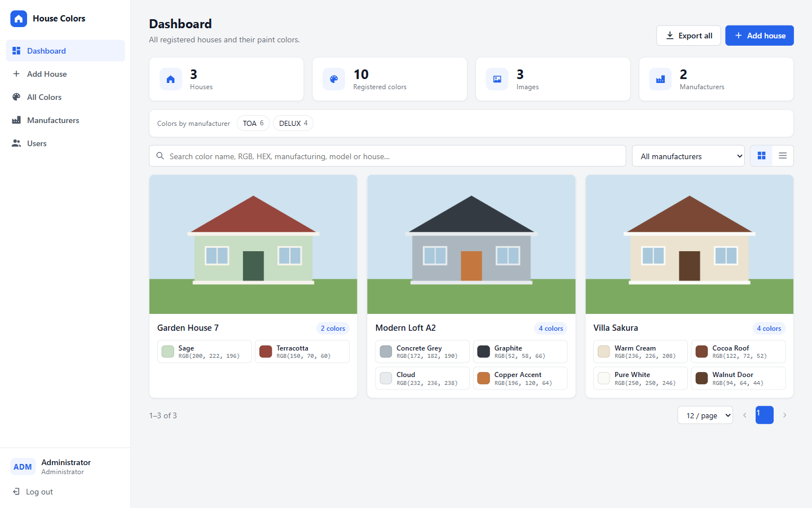

# House Color Management System

Upload house photos, click on them to pick the exact paint colors, record the details (name, RGB/HEX, manufacturer, model), then search the records and export them to Excel.



| Pick a color from the photo (pixel loupe) | Save it with RGB / HEX, manufacturer and model |
|---|---|
|  |  |


*Screenshots use generated sample data.*

| Layer | Tech | Where it runs |
|-------|------|---------------|
| App (pages + API) | Python 3.12, Flask 3, Jinja2 templates, Flask-SQLAlchemy, Pillow, openpyxl | On your machine: `python app.py` |
| Browser scripts | Plain JavaScript modules (no Node, no build step) | Served from `static/` |
| Database | MySQL 8.4 + phpMyAdmin | Docker |

## Quick start (Windows PowerShell)

```powershell
git clone https://github.com/Darkfullmoon/house-color-manager.git
cd house-color-manager

# 1. Database (Docker: MySQL + phpMyAdmin only)
copy .env.example .env               # first time only, then change the passwords
docker compose up -d

# 2. App
.\venv\Scripts\Activate.ps1          # first time: python -m venv venv
pip install -r requirements.txt     # first time only
python app.py
```

| URL | What |
|-----|------|
| http://localhost:5000 | The application (also `http://<your-LAN-IP>:5000` from other devices) |
| http://localhost:8080 | phpMyAdmin (server `mysql`, user/password from `.env`) |
| localhost:3321 | MySQL, for external clients |

`app.py`:
- reads the project's `.env` automatically,
- connects to MySQL at `127.0.0.1` on `MYSQL_PORT` (3321),
- creates the tables on start and seeds the default manufacturers (TOA, DELUX).

Variables you set yourself in the environment take precedence over `.env`.

`python app.py` runs Flask's development server in debug mode, which reloads when you edit code. Templates and static files are picked up on the next page load; there is nothing to build.

Where data is stored:
- **Images** are files in the `uploads/` folder of this project. MySQL stores only the file name (`house_images.image_path`), never the image data.
- **Database** is in the Docker volume `mysql_data`.

Both survive `docker compose down` / `up`. `docker compose down -v` deletes the database volume, but the image files in `uploads/` stay. To back up, copy `uploads/` and dump the database.

## Accounts

Every page, the API, the uploaded images and the Excel downloads need a login.

| Who | Username | Password | Can do |
|-----|----------|----------|--------|
| Administrator | `ADM` (fixed) | `ADMIN_PASSWORD` in `.env` (default `Test*123`) | Everything, plus the **Users** and **Manufacturers** menus |
| User | 3 uppercase English letters, e.g. `ABC` | Their own | Everything except those two menus |

- The administrator adds users on the **Users** page. A new user logs in with the default password (`DEFAULT_PASSWORD` in `.env`, default `Test*123`) and must set their own before using anything else.
- A password needs at least 8 characters with an uppercase letter, a digit and a special character, and cannot be the default password.
- **Reset password** on the Users page puts a user back on the default password (they set a new one at next login). **Disable** logs the user out and blocks the account until it is enabled again.
- To change the administrator's password, edit `ADMIN_PASSWORD` in `.env` and restart `python app.py`.
- Users do not see the Manufacturers menu, but a new manufacturer name typed in the color form is still saved for everyone.

## Environment variables (`.env`)

| Variable | Default | Purpose |
|----------|---------|---------|
| `MYSQL_ROOT_PASSWORD` | – | MySQL root password |
| `DB_NAME` / `DB_USER` / `DB_PASSWORD` | `house_colors` / `housecolor` / – | App database and credentials (used by MySQL and by `app.py`) |
| `MYSQL_PORT` / `PMA_PORT` | 3321 / 8080 | Host ports of MySQL and phpMyAdmin |
| `MAX_UPLOAD_MB` | 20 | Max upload size per request |
| `SECRET_KEY` | – | Signs the login session; use a long random string |
| `ADMIN_PASSWORD` | `Test*123` | Password of the administrator `ADM` |
| `DEFAULT_PASSWORD` | `Test*123` | Password of new users and after a reset |
| `DB_HOST` / `UPLOAD_FOLDER` | `127.0.0.1` / `uploads/` | Optional overrides |

The database credentials only take effect the first time the `mysql_data` volume is created. To change them later, change them inside MySQL as well, or recreate the volume.

## Using it

1. Click **Add house**, enter a name and add one or more photos: upload files, press **Capture screen**, or paste a screenshot with Ctrl+V.
2. On the house page, hover over the photo to see a magnified pixel preview, then click to pick a color. The form opens with that exact pixel's RGB value filled in.
3. Fill in the color details:
   - color name;
   - manufacturing: pick TOA/DELUX, or type a new name, which is saved for next time;
   - model: always stored in UPPERCASE;
   - house.

   You can adjust the RGB value with the sliders, the number inputs, the native color picker or the HEX field.

   For a new color, Manufacturing starts with the manufacturer of that house's latest color, so you choose it once per house. Change it whenever a color is from another brand.
4. The **Dashboard** shows every house with its color swatches.
   - Search covers color name, RGB (`200,180,150`, `200 180 150` or `RGB(200, 180`), HEX, manufacturing, model and house name.
   - You can also filter by manufacturer.
5. **Export all** (Dashboard / All Colors) downloads `House_Color_Database.xlsx`. **Export Excel** on a house page downloads `House_Color_<House_Name>.xlsx`.
   - Columns: House Name, Color Name, RGB, HEX, Manufacturing, Model, Image Reference.
   - The file is built on the server with openpyxl.

### Working from the screen
These need Chrome or Edge on this computer, opened at `http://localhost:5000` (browsers only allow them on `localhost` or HTTPS, and not on phones).

- **Pick from screen** (house page and color form): the pointer becomes an eyedropper. Click any pixel on the screen, also outside the browser, and the color form opens with that color. Esc cancels. A color picked this way has no image reference.
- **Capture screen** (Add house page and house page): the browser asks which screen, window or tab to share; choose one and that picture is added to the house, ready to pick colors from. The browser always asks; this step cannot be skipped.
- **Ctrl+V** on the Add house page or a house page adds an image from the clipboard. Take the screenshot first with Win+Shift+S (cut a region) or PrintScreen, then press Ctrl+V on the page. The page cannot see those keys being pressed, so the Ctrl+V step is needed.

### How the pixel picking works
The image is drawn onto a `<canvas>` at its natural resolution. The click position is mapped from display coordinates back to source pixels, and `getImageData(x, y, 1, 1)` reads that single pixel, so the value is exact even when the image is shown scaled down. Images are served by Flask from the same origin, so the canvas is never "tainted".

## Project layout

```
house-color-manager/
  app.py             all routes: pages, JSON API, uploads, Excel export, validation
  models.py          SQLAlchemy models
  requirements.txt
  templates/         Jinja pages (Flask fills in data on the server)
    base.html          layout + sidebar
    macros.html        swatch, chips, sort headers, pagination
    dashboard.html, colors.html, house_detail.html, add_house.html, manufacturers.html, error.html
    _color_table.html  shared color table
  static/            files sent to the browser as-is
    css/styles.css
    js/              ui.js (toasts, modal, confirm), api.js, color.js,
                     picker.js, color_form.js, manufacturer_select.js, dropzone.js,
                     house_detail.js, add_house.js, colors_page.js, manufacturers.js, color_actions.js
  tests/             pytest (in-memory SQLite, no MySQL needed)
  uploads/           image files
  docker-compose.yml MySQL + phpMyAdmin only
  .env               settings (not committed)
```

### Pages

| Path | Page |
|------|------|
| `/` | Dashboard (`?q=&manufacturer=&view=cards\|table&sort=&order=&page=&per_page=`) |
| `/houses/new` | Add house |
| `/houses/<id>` | House details, picker, colors (`?image=<id>&sort=&order=`) |
| `/colors` | All colors (`?q=&manufacturer=&sort=&order=&page=&per_page=`) |
| `/manufacturers` | Manufacturers (administrator only) |
| `/users` | Users (administrator only) |
| `/login`, `/change-password` | Log in; set or change your own password |
| `/export.xlsx`, `/houses/<id>/export.xlsx` | Excel downloads |

Search, filter, sort and pagination are plain GET parameters handled on the server. The JavaScript only handles the interactive parts: the picker, forms, uploads and deletes. Those parts call the JSON API below.

## Tests

```powershell
python -m pytest tests -q
```

## Database schema

```
houses        id, house_name (unique), created_at, updated_at
house_images  id, house_id → houses (CASCADE), image_path, original_name, created_at
colors        id, house_id → houses (CASCADE), image_id → house_images (SET NULL),
              color_name, rgb ("RGB(r, g, b)"), hex ("#RRGGBB"), manufacturing, model,
              created_at, updated_at
manufacturers id, name (unique), is_default, created_at
users         id, username (3 letters, unique), full_name, role (admin/user), password_hash,
              must_change_password, active, created_at
```

- One house can have many images and many colors.
- Deleting an image keeps its colors but clears their image reference.
- Deleting a house removes its images (rows and files in `uploads/`) and its colors.

## JSON API

| Method | Path | Notes |
|--------|------|-------|
| GET | `/api/health`, `/api/stats` | |
| GET | `/api/houses?q=&manufacturer=` | Houses with images and colors; includes `matched_color_ids` when filtered |
| POST | `/api/houses` | JSON `{house_name}` or multipart `house_name` + `images[]` |
| GET/PUT/DELETE | `/api/houses/:id` | |
| POST | `/api/houses/:id/images` | multipart `images[]` |
| DELETE | `/api/images/:id` | |
| GET | `/api/colors?q=&manufacturer=&house_id=&sort=&order=&page=&per_page=` | |
| POST | `/api/colors` | `{color_name, r,g,b \| rgb \| hex, manufacturing, model, house_id \| house_name, image_id?}` |
| GET/PUT/DELETE | `/api/colors/:id` | |
| GET/POST | `/api/manufacturers` | POST is administrator only |
| DELETE | `/api/manufacturers/:id` | Custom manufacturers only, and only when no color uses them |
| GET | `/api/export[?house_id=]` | Export rows as JSON |
| GET | `/uploads/:file` | Uploaded images |
| GET/POST | `/api/users` | Administrator only. POST `{username, full_name}` |
| PUT | `/api/users/:id` | Administrator only. `{full_name?, active?}` |
| POST | `/api/users/:id/reset-password` | Administrator only |

Every call needs a logged-in session (`401` otherwise), and every call that changes data needs the `X-CSRF-Token` header (the value is in the page's `<meta name="csrf-token">`; `static/js/api.js` sends it). Administrator-only calls return `403` for users.

Validation errors return `422 {error, fields: {field: message}}`. Unknown `/api/...` paths return JSON errors; unknown pages return an HTML error page.

## Upload security
- Only these extensions are allowed: png, jpg/jpeg, webp, gif, bmp.
- Pillow checks the actual file content, not just the extension.
- There is a size limit (`MAX_UPLOAD_MB`).
- Files get random UUID names, and path traversal is blocked when serving them.
- Image bytes are never stored in MySQL.
- User text is always escaped: Jinja autoescape in templates, `textContent` in JavaScript.
